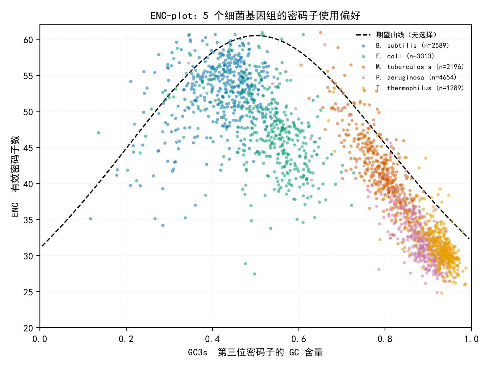
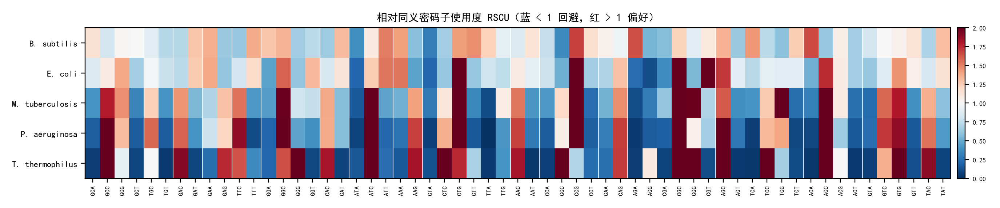
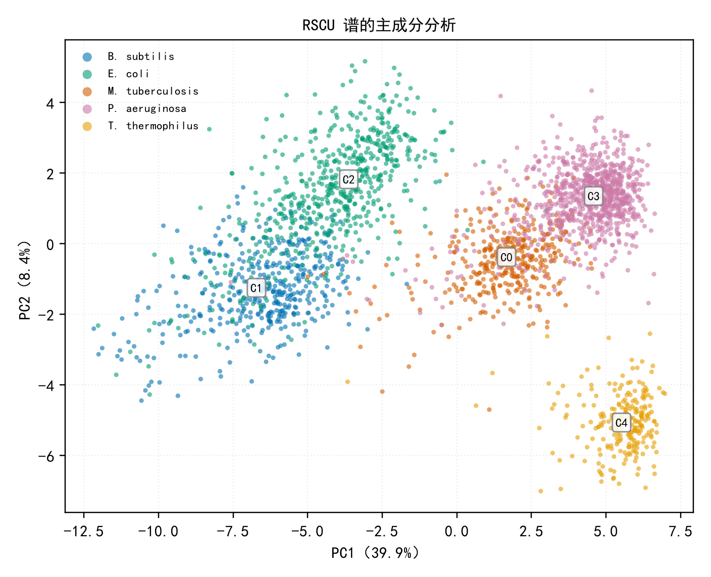
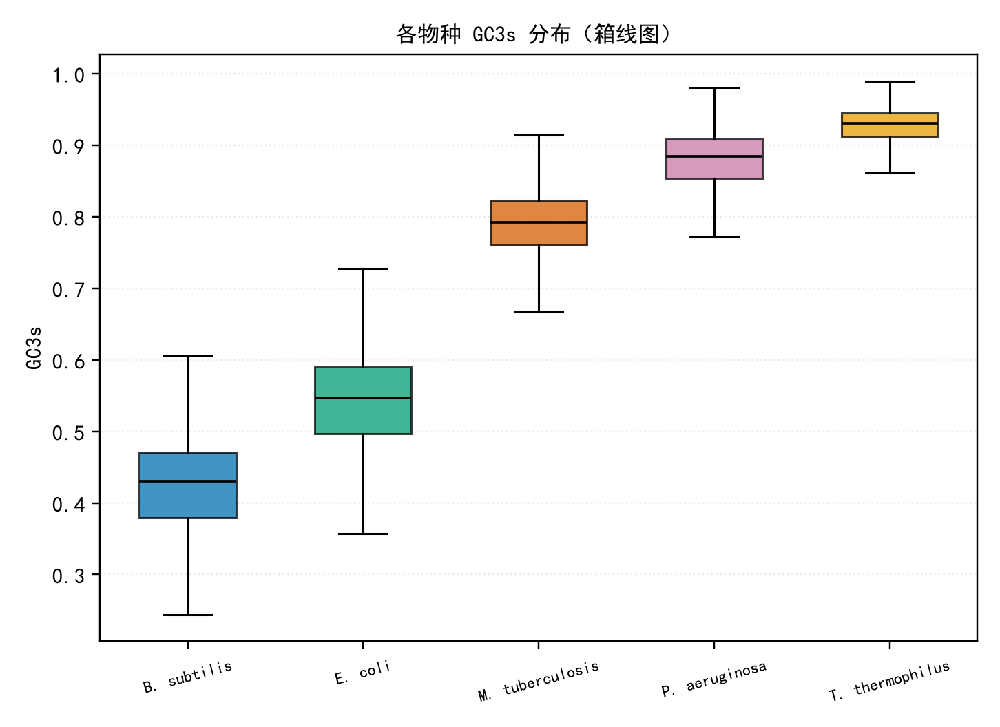
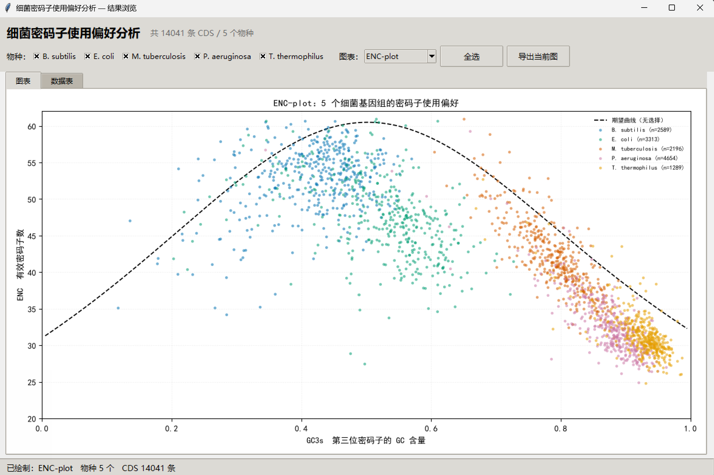

# 五种细菌全基因组密码子使用偏好的量化分析与物种聚类

> 《用 Python 玩转数据》实践项目报告
> （因为自己是生物信息学专业的大二本科生，所以选择了生物信息方向的实践项目）
>
> ai使用说明：使用 DeepSeek-V41-Flash 进行代码改进、文献查找及翻译、报告润色

---

## 摘要

密码子使用偏好（codon usage bias）是指同一氨基酸的同义密码子在基因组中并非均匀使用。本项目以 5 种 GC 含量差异显著的细菌为对象，从 NCBI 取回 5 个参考基因组的全部编码序列，经统一清洗规则保留 14,041 条 CDS，自行实现相对同义密码子使用度（RSCU）、第三位密码子 GC 含量（GC3s）与有效密码子数（ENC）三项指标，并绘制 ENC-plot、RSCU 热图、主成分分析与箱线图。
结果显示：GC3s 由 0.4199（枯草芽孢杆菌）升至 0.9216（嗜热栖热菌），对应平均 ENC 由 52.54 降至 31.63，两者在全部 14,041 条 CDS 上呈强负相关（r = −0.8554）；95.42% 的基因落在 ENC 期望曲线下方，且选择最强的基因是大肠杆菌的糖酵解酶与核糖体蛋白基因（eno、gapA、groL、rpsI、rpsA）。以 59 维 RSCU 谱做 PCA 后，第一主成分解释 39.89% 的方差，K-means（k=5）聚类纯度 0.9143，说明密码子偏好具有很强的物种特异性，可视为一种"基因组指纹"。

结论上最值得强调的有两点。一是密码子偏好强度与基因组 GC 含量高度耦合，且高表达基因的偏好系统性更强，这两方面证据方向一致，共同支持"突变压力打底、翻译选择加强"的图像。二是这种耦合关系只在物种层面成立——枯草芽孢杆菌组内 GC3s 与 ENC 反而呈正相关（+0.3180），说明相关性的解读必须明确指出它成立的层级，不能由组间关系直接推断组内规律。

---

## 一、背景与问题

### 1.1 什么是密码子使用偏好

遗传密码具有简并性：61 个密码子编码 20 种氨基酸，除甲硫氨酸（ATG）和色氨酸（TGG）外，其余 18 种氨基酸都有 2–6 个同义密码子。若同义密码子被等概率使用，则每个氨基酸的 RSCU 应恒为 1。但实际基因组中普遍存在偏用与回避，这一现象即密码子使用偏好。

### 1.2 为什么会存在偏好

主流解释有两条相互交织的机制：

1. **突变压力（mutational bias）**：基因组整体的 GC 含量会影响第三位密码子的碱基组成，GC 高的基因组倾向使用以 G/C 结尾的同义密码子。
2. **翻译选择（translational selection）**：高表达基因倾向于使用与胞内 tRNA 丰度匹配的密码子，以提高翻译效率与 accuracy。这类基因的 ENC 通常更低。

### 1.3 为什么值得分析

- **异源表达优化**：把人的基因放到大肠杆菌里表达，若不按宿主偏好改写密码子，表达量可能很低。
- **基因组特征刻画**：密码子偏好可当作"基因组指纹"，用于物种判别与水平基因转移检测。
- **进化研究**：偏好强度与有效群体大小、GC 偏倚、生活方式相关。

### 1.4 本项目要回答的问题

1. 5 种细菌的密码子偏好强度差异有多大？能否用 ENC 与 GC3s 定量刻画？
2. 偏好是否主要由 GC 含量（突变压力）驱动？
3. 仅凭 59 维 RSCU 谱，能否在不告诉算法物种标签的情况下把 5 个物种分开？

---

## 二、数据与方法

### 2.1 数据来源

数据取自 NCBI Nucleotide 数据库的 RefSeq 参考基因组（每个物种一条染色体），通过 Biopython 的 `Bio.Entrez` 以 `rettype="fasta_cds_na"` 一次性取回该基因组注释的全部 CDS。

| 物种（拉丁学名） | 中文名 | 登录号 | 遗传密码表 | GC 档位 |
|---|---|---|---|---|
| Bacillus subtilis | 枯草芽孢杆菌 | NC_000964.3 | 11 | 低 GC |
| Escherichia coli | 大肠杆菌 | NC_000913.3 | 11 | 中 GC |
| Mycobacterium tuberculosis | 结核分枝杆菌 | NC_000962.3 | 11 | 高 GC |
| Pseudomonas aeruginosa | 铜绿假单胞菌 | NC_002516.2 | 11 | 高 GC |
| Thermus thermophilus | 嗜热栖热菌 | NC_006461.1 | 11 | 极高 GC |

> 说明：登录号均经 NCBI esummary 核对了物种名与序列长度；数据已缓存到本地 `data/`，保证分析可离线复现。5 个物种均为细菌，使用同一套遗传密码表（NCBI 表 11），因此指标之间可直接比较。

**为什么选这 5 个物种。** 它们的基因组 GC 含量恰好排成一条从低到高的梯度，便于观察"碱基组成变化时，密码子使用偏好如何随之变化"，而且都是已完成全基因组测序、注释质量较高的代表性菌株。按通俗的说法：枯草芽孢杆菌与大肠杆菌是分子生物学里最常用的两种模式菌；结核分枝杆菌是结核病的病原菌；铜绿假单胞菌是一种常见的条件致病菌；嗜热栖热菌生活在温泉等高温环境，是研究耐热蛋白与耐热酶的常用菌株。

### 2.2 CDS 清洗

注释文件中的 CDS 并非都能直接用于计算，按以下规则过滤（参数见 `config.py`）：

| 规则 | 阈值 / 条件 |
|---|---|
| 序列必须完整 | 长度是 3 的倍数、以终止密码子结尾 |
| 无内部终止 | 编码区中间不得出现 TAA/TAG/TGA |
| 起始密码子 | 只保留 ATG 起始 |
| 最短长度 | ≥ 100 个密码子 |
| 模糊碱基 | A/C/G/T 占比 ≥ 99% |
| ENC 有效范围 | 剔除 ENC ∉ [20, 61] 的估计异常值（原因见 2.3） |

过滤结果：

| 物种 | 原始 CDS 记录 | 保留 | 保留率 | 过短 | 非 ATG 起始 | ENC 越界 | 无终止 | 内部终止 | 非 3 倍数 |
|---|---|---|---|---|---|---|---|---|---|
| B. subtilis | 4237 | 2589 | 61.10% | 473 | 954 | 221 | 0 | 0 | 0 |
| E. coli | 4318 | 3313 | 76.73% | 480 | 425 | 94 | 2 | 3 | 1 |
| M. tuberculosis | 3906 | 2196 | 56.22% | 197 | 1500 | 13 | 0 | 0 | 0 |
| P. aeruginosa | 5572 | 4654 | 83.52% | 310 | 604 | 3 | 0 | 1 | 0 |
| T. thermophilus | 1957 | 1289 | 65.87% | 124 | 516 | 0 | 6 | 2 | 20 |
| **合计** | **19990** | **14041** | — | — | — | — | — | — | — |

可以看到，"非 ATG 起始"是最大的剔除原因，尤其在结核分枝杆菌中被剔除 1500 条。这与细菌普遍使用 GTG/TTG 作为起始密码子的事实一致（见 4.3 局限性）。

### 2.3 三项指标的定义

**（1）RSCU —— 相对同义密码子使用度**

$$\mathrm{RSCU}_i = \frac{X_i}{\frac{1}{k}\sum_{j=1}^{k} X_j}$$

其中 $X_i$ 为密码子 $i$ 的观测次数，$k$ 为该氨基酸的同义密码子个数。RSCU = 1 表示随机使用，> 1 表示偏好，< 1 表示回避。甲硫氨酸与色氨酸不参与计算。

**（2）GC3s —— 第三位密码子 GC 含量**

只统计第 3 位碱基中 G/C 的比例，按惯例排除 Met、Trp 与终止密码子。它衡量突变压力对密码子使用的影响。

**（3）ENC —— 有效密码子数（Wright, 1990）**

$$
F_k = \frac{n\sum_i p_i^2 - 1}{n - 1}, \qquad
\mathrm{ENC} = 2 + \frac{9}{F_2} + \frac{1}{F_3} + \frac{5}{F_4} + \frac{3}{F_6}
$$
$n$ 为某简并家族的密码子总数，$p_i$ 为各同义密码子频率，$F_2/F_3/F_4/F_6$ 分别在相应简并度的家族内取平均。系数 9/1/5/3 正好对应标准遗传密码中 2/3/4/6 简并家族的个数。ENC 取值 20（极端偏好，每个氨基酸只用一种密码子）到 61（完全随机）。

**（4）ENC 期望曲线**

$$\mathrm{ENC_{exp}} = 2 + \mathrm{GC3s} + \frac{29}{\mathrm{GC3s}^2 + (1-\mathrm{GC3s})^2}$$

这条曲线描述"只受突变压力影响、没有翻译选择"时的理论关系。实际点落在曲线下方，说明该基因还受到了额外的选择压力。

> **关于 ENC 越界**：Wright 的估计量在某个高简并家族（6 简并的 Leu/Arg/Ser）密码子数极少时会因 $F_k \to 0$ 而溢出，出现 ENC > 61 的不可靠值。本项目按 [20, 61] 剔除这类记录（共 331 条），而不是把数字强行截断到 61。这一处理会影响均值，必须在方法中声明。

### 2.4 统计与降维方法

- **相关性**：Pearson 相关系数。除全基因池外，还分别在每个物种内部计算（避免辛普森悖论）。
- **PCA**：对 59 维 RSCU 向量标准化后做奇异值分解（SVD）取前两个主成分。
- **K-means**：$k$ 固定为 5（等于物种数），用轮廓无关的"聚类纯度"评价——每个簇取占多数的真实物种，正确数除以总数。
- **实现**：PCA 为手写 SVD，不依赖 sklearn；K-means 用 sklearn（缺失时自动退回 numpy 实现）。
- **随机性**：K-means `random_state=42`，绘图抽样 `seed=42`。

---

## 三、结果

### 3.1 物种层面的总体差异

| 物种 | 保留 CDS | 平均密码子数 | 平均 GC3s | GC3s 标准差 | 平均 ENC | ENC 标准差 | ENC 最小 | ENC 最大 |
|---|---|---|---|---|---|---|---|---|
| B. subtilis | 2589 | 342.7 | 0.4199 | 0.0764 | 52.54 | 4.66 | 28.29 | 60.95 |
| E. coli | 3313 | 348.7 | 0.5360 | 0.0820 | 47.16 | 5.66 | 25.28 | 60.97 |
| M. tuberculosis | 2196 | 360.9 | 0.7869 | 0.0550 | 42.35 | 5.08 | 25.07 | 60.99 |
| P. aeruginosa | 4654 | 349.9 | 0.8715 | 0.0628 | 32.91 | 4.88 | 23.43 | 60.86 |
| T. thermophilus | 1289 | 329.2 | 0.9216 | 0.0442 | 31.63 | 3.73 | 23.86 | 59.96 |

两个趋势非常清晰：**GC3s 越高的物种，平均 ENC 越低**（偏好越强）。
从枯草芽孢杆菌到嗜热栖热菌，GC3s 从 0.4199 升到 0.9216，平均 ENC 从 52.54 降到 31.63 —— 后者已接近"每个氨基酸只用一两种密码子"的极端状态。

这一结果说明：在所选的 5 个物种范围内，**基因组碱基组成是密码子偏好强度最主要的解释变量**。
GC3s 从 0.4199 到 0.9216 的跨度，对应 ENC 从 52.54 到 31.63，后者意味着嗜热栖热菌几乎"每个氨基酸只用一两种密码子"，密码子使用已接近极端偏好状态。
不过要注意，GC3s 与 ENC 的这种对应关系是**物种层面**的统计关系，并不代表物种内部每个基因都遵循同一规律 —— 这一点在 3.5 节会看到反例。

### 3.2 ENC-plot：偏好强度与突变压力的关系



图中虚线为无选择的期望曲线。两点值得注意：

1. 绝大多数点落在曲线**下方**，说明翻译选择在所有这些基因组中都起作用；点越靠下，偏好越强。
2. 5 个物种沿曲线右段分层排列：嗜热栖热菌与铜绿假单胞菌集中在右下方（高 GC3s + 低 ENC），枯草芽孢杆菌集中在左上方（低 GC3s + 高 ENC）。

**离群点与定量结果**（由 `06_extra_stats.py` 计算）：以"实测 ENC − 期望 ENC"为残差，全部 14,041 条基因中有 **95.42%** 落在曲线下方，残差中位数 **−6.87**，区间为 [−33.06, +14.04]。各物种的残差中位数分别为：大肠杆菌 −11.86、铜绿假单胞菌 −7.44、嗜热栖热菌 −5.40、枯草芽孢杆菌 −5.29、结核分枝杆菌 −4.32。

**曲线下方最远的 5 条基因全部来自大肠杆菌**，而且身份高度一致：

| 基因 | 产物 | 密码子数 | ENC | 期望 ENC | 残差 |
|---|---|---|---|---|---|
| eno | 烯醇化酶（糖酵解） | 432 | 27.43 | 60.50 | −33.06 |
| gapA | 3-磷酸甘油醛脱氢酶（糖酵解） | 331 | 27.92 | 60.49 | −32.57 |
| groL | 分子伴侣 GroEL | 548 | 28.39 | 60.50 | −32.10 |
| rpsI | 核糖体蛋白 S9 | 130 | 28.85 | 60.34 | −31.49 |
| rpsA | 核糖体蛋白 S1 | 557 | 29.29 | 60.47 | −31.19 |

这些都是细菌中表达量最高的基因类别（糖酵解酶、分子伴侣、核糖体蛋白、翻译因子）。
把它们与全基因池对比，结论更直接：

| 物种 | 高表达基因条数 | 全池平均 ENC | 高表达基因平均 ENC | 差值 |
|---|---|---|---|---|
| B. subtilis | 10 | 52.54 | 39.03 | 13.50 |
| E. coli | 15 | 47.16 | 31.06 | 16.10 |
| M. tuberculosis | 6 | 42.35 | 37.15 | 5.20 |
| P. aeruginosa | 12 | 32.91 | 30.54 | 2.37 |
| T. thermophilus | 10 | 31.63 | 29.30 | 2.32 |

5 个物种里高表达基因的 ENC **无一例外都低于全基因池**，这正是"翻译选择"预期的方向：
高表达基因需要更高的翻译效率与准确性，因而更偏向使用与胞内 tRNA 丰度匹配的密码子。这与 Sharp 与 Li 提出的用高表达基因作参考集来评估密码子适应性的思路一致（CAI，Sharp & Li, 1987）。

另一个值得注意的细节是**差值随基因组 GC 升高而迅速收窄**（从大肠杆菌的 16.10 降到嗜热栖热菌的 2.32）。可能的解释是[推断]：在高 GC 基因组里，突变压力已经把全部基因推向高度偏好的状态，高表达基因"还能再偏"的空间本就很小，因此它与全池的差距被压缩。

**曲线上方（残差为正）的离群点**则集中在枯草芽孢杆菌：`lrpA`（GC3s = 0.209，ENC = 59.57，残差 +14.04）与 `yokL`（GC3s = 0.216，ENC = 58.09，残差 +12.05）。
这类基因的 ENC 已接近理论最大值 61，即同义密码子几乎被均匀使用，基本看不到选择留下的痕迹，可能与表达水平很低、或刚经历水平转移有关[推断]。

### 3.3 RSCU 谱：偏好哪些密码子



各物种 RSCU 最高（最偏好）与最低（最回避）的密码子：

| 物种 | 偏好前三 | 回避前二 |
|---|---|---|
| B. subtilis | CCG (1.69)、ACA (1.65)、AGA (1.65) | CTA (0.31)、CCC (0.36) |
| E. coli | CTG (3.00)、CGC (2.40)、CGT (2.31) | AGG (0.12)、ATA (0.21) |
| M. tuberculosis | CTG (3.05)、ATC (2.37)、ACC (2.34) | TTA (0.10)、AGA (0.12) |
| P. aeruginosa | CTG (3.98)、CGC (3.90)、ACC (3.09) | TTA (0.01)、AGA (0.04) |
| T. thermophilus | CCC (3.00)、CTC (3.00)、GCC (2.95) | AAT (0.03)、TCA (0.04) |

高 GC 的三个物种（结核分枝杆菌、铜绿假单胞菌、嗜热栖热菌）高度趋同：都以 G/C 结尾的密码子为偏好，以 A/T 结尾的密码子为回避。铜绿假单胞菌的 TTA 的 RSCU 仅 0.01，几乎完全不用。而低 GC 的枯草芽孢杆菌偏好模式明显不同（CCG、ACA、AGA 并列），说明它的密码子使用更多受自身基因组碱基组成约束。

这里挑"最意外"的一类密码子来看。精氨酸有 6 个同义密码子，正好能展示偏好如何在物种间被彻底重塑：

| 物种 | CGT | CGC | CGA | CGG | AGA | AGG |
|---|---|---|---|---|---|---|
| B. subtilis | 1.10 | 1.23 | 0.57 | 0.89 | **1.65** | 0.54 |
| E. coli | 2.31 | 2.40 | 0.38 | 0.55 | 0.24 | 0.12 |
| M. tuberculosis | 0.70 | 2.30 | 0.60 | 1.98 | 0.12 | 0.30 |
| P. aeruginosa | 0.66 | **3.90** | 0.18 | 1.05 | 0.04 | 0.17 |
| T. thermophilus | **0.11** | 2.10 | 0.07 | 2.57 | 0.05 | 1.10 |

最意外的是 **CGT**：在大肠杆菌里 RSCU = 2.31（偏好），在嗜热栖热菌里只有 0.11（几乎不用）——
同一个密码子在不同物种中命运完全相反。枯草芽孢杆菌则偏好 AGA（1.65），是 5 个物种里唯一偏好 A 结尾精氨酸密码子的。

接着验证" CGT 在大肠杆菌里是不是高表达基因的偏好密码子"，结果支持这一判断：

| 密码子 | 全基因池 RSCU | 高表达基因 RSCU | 差值 | 方向 |
|---|---|---|---|---|
| CTG（Leu） | 3.00 | 5.39 | +2.39 | 偏好 |
| **CGT（Arg）** | **2.31** | **4.33** | **+2.03** | 偏好 |
| TCT（Ser） | 0.88 | 2.63 | +1.74 | 偏好 |
| ATC（Ile） | 1.25 | 2.59 | +1.34 | 偏好 |
| CCG（Pro） | 2.05 | 3.35 | +1.30 | 偏好 |
| ATT（Ile） | 1.54 | 0.41 | −1.13 | 回避 |
| ACG（Thr） | 1.08 | 0.12 | −0.96 | 回避 |
| GTG（Val） | 1.45 | 0.55 | −0.90 | 回避 |

也就是说，CGT 在大肠杆菌的高表达基因中被进一步富集（2.31 → 4.33），而 ATT、ACG、GTG 这类密码子则被系统性地避开。这与"高表达基因偏好与 tRNA 丰度匹配的密码子"的翻译选择模型一致（Sharp & Li, 1987）。
需要说明的是，这一步只做了 15 条高表达基因与全池的对比，属于小样本的描述性证据，要严格论证还需引入表达量数据或计算 CAI。

### 3.4 PCA 与聚类：密码子偏好能否当"物种指纹"



- PC1 解释 **39.89%** 的方差，PC2 解释 **8.41%**，PC3 解释 4.15%。
- PC1 正端载荷最高的密码子是以 G/C 结尾的 ATC、GCC、GAC、TTC、ACC；负端是 GAT、TTT、ATT、AAA、TTA —— **PC1 本质上是一条"GC 偏好轴"**。
- K-means（k=5）聚类纯度 **0.9143**（本机未安装 scikit-learn，使用脚本内置的 numpy 版 k-means++），各簇组成：

| 簇 | CDS 数 | 主导物种 | 占比 |
|---|---|---|---|
| 0 | 2591 | M. tuberculosis | 79.93% |
| 1 | 3038 | B. subtilis | 83.74% |
| 2 | 2923 | E. coli | 97.13% |
| 3 | 4220 | P. aeruginosa | 97.56% |
| 4 | 1269 | T. thermophilus | 99.76% |

也就是说，**在不告诉算法任何物种标签的情况下，仅凭 59 维 RSCU 谱，约 91.4% 的基因被聚到了自己物种的簇里**。
错分并非随机分布：两个纯度最低的簇（C0 与 C1）分别吸收了 477 条铜绿假单胞菌基因和 442 条大肠杆菌基因，即误分主要发生在 GC3s 彼此相邻的两个物种之间。

> **关于这个数字的稳定性**：装了 scikit-learn 时用 sklearn 版 K-means，纯度 0.9145；没装时脚本自动退回自己写的 numpy 版 K-means++，纯度 0.9143 —— 只差 3 条基因，属于边界基因的归属差异，不影响结论。

为什么 C0（结核分枝杆菌）与 C1（枯草芽孢杆菌）两个簇的纯度偏低？
一个可检验的解释是：被分错的基因，其密码子谱本来就"长得像"接收方物种。
把被分错的基因单独取出来，比较它们的 GC3s 与两个物种均值的距离（`06_extra_stats.py` 第 7 项）：

| 物种 | 错分去向（接收方及其 GC3s） | 条数 | GC3s 距接收方 | GC3s 距自身 |
|---|---|---|---|---|
| B. subtilis | C2（E. coli，0.5360） | 42 | **0.0045** | 0.1116 |
| E. coli | C1（B. subtilis，0.4199） | 442 | **0.0164** | 0.1325 |
| M. tuberculosis | C3（P. aeruginosa，0.8715） | 92 | **0.0190** | 0.0655 |
| P. aeruginosa | C0（M. tuberculosis，0.7869） | 477 | **0.0099** | 0.0746 |

四行呈现同一个模式：错分基因的 GC3s 与**接收方**物种均值的差距只有 0.0045–0.0190，而与自己物种均值的差距是 0.0655–0.1325，前者约小一个数量级。
最典型的是大肠杆菌：有 442 条基因（占其 3313 条的 13.3%）被聚进枯草芽孢杆菌的簇，这批基因的平均 GC3s 与枯草芽孢杆菌的 0.4199 仅相差 **0.0164**，而与大肠杆菌自身均值 0.5360 相差 **0.1325** —— 前者比后者小约一个数量级。

结论：**这些基因的偏好在 GC 意义上"属于"另一个物种**，它们的 RSCU 谱本质上是 GC 驱动的，因此当某个基因的 GC3s 恰好落在邻居物种的区间时，仅凭 59 维 RSCU 无法把它判回原物种。
**这并不否定"物种指纹"的结论，但界定了它的适用边界：**指纹在 GC3s 处于物种典型区间的基因上最可靠。

值得一提的反例是嗜热栖热菌：它的 GC3s（0.9216）与铜绿假单胞菌（0.8715）最接近，但错分只有 23 条（1.8%）。这说明它的密码子使用带有超出 GC 的自身特征（如 3.3 节中 CGG = 2.57、CGT = 0.11 的独特组合），因此即使 GC 接近仍能被清楚地区分。

### 3.5 相关性分析

| 分析范围 | Pearson r | n |
|---|---|---|
| 全部 CDS | **−0.8554** | 14041 |
| B. subtilis 内部 | **+0.3180** | 2589 |
| E. coli 内部 | −0.4438 | 3313 |
| M. tuberculosis 内部 | −0.8115 | 2196 |
| P. aeruginosa 内部 | −0.8109 | 4654 |
| T. thermophilus 内部 | −0.8102 | 1289 |
| 物种层面（均值） | −0.9633 | 5 |

这是本项目最值得讨论的一组数字：**全局强负相关（−0.8554），但组内相关差异极大**。

- 三个高 GC 物种组内依然强负相关（约 −0.81），说明组内也是 GC 驱动。
- 大肠杆菌组内只有中等负相关（−0.4438）。
- 枯草芽孢杆菌组内竟然**转为正相关**（+0.3180）。

其中枯草芽孢杆菌最值得深究：它的组内相关系数与全局符号相反。
首先排除"样本太少"或"极短基因干扰"这两种可能——稳健性检验（`06_extra_stats.py` 第 6 项）结果如下：

| 筛选条件 | 基因数 | r(GC3s, ENC) |
|---|---|---|
| 全部 | 2589 | +0.3180 |
| 仅 ≥150 密码子 | 2287 | +0.2924 |
| 仅 ≥200 密码子 | 1961 | +0.2758 |
| 仅 ≥250 密码子 | 1651 | +0.3095 |
| 仅 ≥300 密码子 | 1277 | +0.3231 |

逐级抬高长度门槛后，相关系数始终稳定在 +0.28 到 +0.32，并没有向负值收敛；同时 r(GC3s, 基因长度) 仅为 +0.1355，说明基因长度不是混淆因素。
因此这是一个**真实的组内现象**，而不是抽样或长度造成的伪相关。

对这一现象有三点解释：

1. **全局相关主要来自物种间差异**。全部 CDS 的 r = −0.8554，而物种层面（每个物种一个点）r = −0.9633，两者都比枯草芽孢杆菌组内的 +0.3180 强得多。这说明负相关优势由"物种之间"的巨大跨度贡献；直接把组间关系当作组内规律，正是区群谬误（ecologic fallacy）的典型情形。
2. **低 GC 物种内部 GC3s 的变异范围本来就窄**（枯草芽孢杆菌 GC3s 的四分位距 0.0910），此时其它因素——基因表达水平、氨基酸组成对可用密码子的限制、局部 GC 偏倚——的相对作用会上升，可能盖过 GC3s 本身。
3. **要区分"突变压力"与"翻译选择"的贡献，必须引入基因层面的表达量数据**（如 RNA-seq），或以高表达基因集为参考计算 CAI（Sharp & Li, 1987）。本项目没有表达量数据，因此只能报告这一相关性的存在与稳健性，不能对机制下结论。

这也是本项目在方法上的一个重要教训：**相关性必须在正确的层级上讨论**。物种层面的规律不能直接搬到基因层面，反之亦然。

### 3.6 GC3s 的组内分布



箱线图显示组间中位数几乎不重叠，且组内离散程度差异明显：
大肠杆菌的箱子最高（标准差 0.0820），嗜热栖热菌最窄（0.0442）。说明高 GC 物种的密码子使用更"整齐"，低 GC 物种基因间异质性更大。

这种"离散程度随 GC 升高而收窄"的趋势，用三个离散度量一起看更清楚：

| 物种 | 平均 GC3s | 标准差 | 四分位距 | 变异系数 |
|---|---|---|---|---|
| B. subtilis | 0.4199 | 0.0764 | 0.0910 | 0.1819 |
| E. coli | 0.5360 | 0.0820 | 0.0931 | 0.1530 |
| M. tuberculosis | 0.7869 | 0.0550 | 0.0625 | 0.0698 |
| P. aeruginosa | 0.8715 | 0.0628 | 0.0547 | 0.0721 |
| T. thermophilus | 0.9216 | 0.0442 | 0.0336 | 0.0479 |

三个度量随平均 GC3s 升高而一致下降：r(平均GC3s, 标准差) = −0.8749，r(平均GC3s, 变异系数) = −0.9884（n = 5，样本量很小，只能作描述性参考）。

还有一项更能说明问题的量——GC3s 与整体 CDS GC 的差值：

| 物种 | CDS 整体 GC | 平均 GC3s | GC3s − GC |
|---|---|---|---|
| B. subtilis | 44.22% | 41.99% | −2.23 |
| E. coli | 51.90% | 53.60% | +1.70 |
| M. tuberculosis | 65.91% | 78.69% | +12.78 |
| P. aeruginosa | 67.16% | 87.15% | +19.99 |
| T. thermophilus | 69.67% | 92.16% | +22.49 |

（整体 GC 由 `06_extra_stats.py` 直接统计缓存的 CDS 序列得到，不是引用外部数值。）

该差值从 −2.23 单调升至 +22.49，与整体 GC 的相关系数 r = +0.9677。
也就是说，**基因组 GC 越高的物种，其密码子第三位被"额外"推向 G/C 的程度越大**：
第三位的 GC 含量系统性地超出基因组平均水平，而这一超出量随 GC 升高而放大。

关于"为什么嗜热菌的分布这么窄"，数据支持两条叠加的原因：

1. **天花板效应**：嗜热栖热菌的平均 GC3s 已达 0.9216（5% 分位 0.8512，95% 分位 0.9644），距理论最大值 1 只剩不到 0.08，向上的余地被压缩，分布自然变窄[推断]。
2. **偏好方向高度一致**：它的偏好密码子全部以 G/C 结尾（CCC、CTC、GCC、CGG、CGC），基因之间不存在"有的偏好 A/T、有的偏好 G/C"的分化，离散度因此更小。

从生物学背景上，嗜热菌基因组偏高的 GC 常被解释为对热稳定性的适应，而本项目观察到的"第三位额外偏 GC"可能是这一整体偏倚在简并位点上的放大[推断]。
需要强调的是，**GC 含量与最适生长温度的关系在文献中本身仍有争议**，本项目的数据也无法检验这一假说，因此这里只作为待检验的推测，不作为结论。

---

## 四、讨论

### 4.1 主要发现

1. 密码子偏好强度与基因组 GC 含量高度耦合：GC3s 升高伴随 ENC 下降，物种层面 r = −0.9633。
2. 偏好具有强物种特异性：仅凭 59 维 RSCU 谱即可把 91.4% 的基因归回原物种。
3. 高表达基因的偏好系统性更强：5 个物种中高表达基因的 ENC 全部低于全基因池，且残差最负的基因正是糖酵解酶与核糖体蛋白基因。
4. 第三位密码子的 GC 含量系统性地高于基因组整体 GC，且这一超出量随 GC 升高而放大（从 −2.23 到 +22.49 个百分点，r = +0.9677）。
5. 物种内部的规律与物种之间**并不一致**，提示单一因素（GC）不足以解释组内变异。

### 4.2 与已有认识的关系

**与 Wright (1990) 的对照。** 本项目采用的 ENC 定义与期望曲线公式均源自该文。Wright 给出两点：其一，ENC 的取值范围是 20（极端偏好）到 61（完全随机），且该度量与基因长度、氨基酸组成基本无关；其二，以 ENC 对同义位点 GC 含量作散点（即 Nc-plot），无选择时点应落在理论曲线上，存在选择时点会落到曲线下方。

本项目的结果与这两点一致：

- 实测 ENC 的范围是 23.43–60.99，完整落在 20–61 之内，说明指标实现正确、未出现越界或量纲错误（这也是我们把 ENC ∉ [20,61] 的记录判定为估计失败并剔除的依据）。
- 95.42% 的基因落在期望曲线下方，且选择最强的基因是高表达基因，正是该文所述"点落在曲线下方表示选择"的预期方向。
- Wright 原文即以大肠杆菌与枯草芽孢杆菌为例绘制 Nc-plot，本项目的两个物种同样呈现"大肠杆菌明显偏离曲线、枯草芽孢杆菌更靠近曲线"的格局（残差中位数−11.86 与 −5.29），方向上与原始报道吻合。

**与 Sharp 等 (2005) 的对照。** 该文对 80 个系统发育上分散的细菌定量了"选择的密码子偏好强度" S，发现 S 在物种间差异很大，约 30% 的基因组没有检出选择有效的证据，并且 S 与 rRNA 操纵子数、tRNA 基因数正相关，据此提出"快速生长的物种选择更强"。

本项目虽未计算 S，但两个现象与之一致：一是选择强度的物种差异明显（残差中位数从 −4.32 到 −11.86，相差约两倍），二是高表达基因的 ENC 优势在大肠杆菌最明显（差值 16.10）而在嗜热栖热菌最弱（2.32）。这提示"选择强度本身是物种特异的变量"，而不能假设所有细菌的密码子偏好都同等强。

需要说明的是，上述对照属于方向性吻合，并非定量验证：S 的计算需要 tRNA 基因拷贝数与表达量数据，本项目均未获取。

### 4.3 局限性

1. **只保留 ATG 起始**：细菌中相当比例基因以 GTG/TTG 起始（本项目因此剔除 3999 条，以结核分枝杆菌最突出）。这批基因可能在功能或表达水平上系统性不同，因此样本存在选择偏倚，不能声称代表"全基因组所有基因"。
2. **未纳入表达量**：ENC 低只能说明"使用集中"，不能直接等同于"翻译选择强"。要论证选择，需要引入 RNA-seq / 核糖体测序数据，或计算 CAI。
3. **单一菌株代表物种**：每个物种只用了一条参考染色体，菌株间差异（尤其大肠杆菌这种高度多样性物种）未考虑。
4. **ENC 估计量的数值不稳**：短基因或高简并家族密码子很少时 ENC 会溢出，本项目已剔除 331 条越界记录，但边界附近的估计仍有噪声。
5. **未区分基因功能类别**：核糖体蛋白基因与代谢基因的偏好强度通常不同，混合统计会平滑掉这类结构。

### 4.4 可以继续做的

1. **按功能类别分组比较**。本项目只用 15 条高表达基因做了小样本对照，若接入 COG 功能分类，可以把核糖体蛋白、能量代谢、膜转运等类别分开统计，看"功能—偏好强度"的关系是否稳定。
2. **计算 CAI 并与 ENC 对照**。CAI 以高表达基因集为参考，能更直接地反映"适应宿主翻译系统"的程度（Sharp & Li, 1987）。把 CAI 与 ENC 画在一起，可以判断两个指标是否给出一致的排序。
3. **引入表达量数据**。这是回答"低 ENC 是否等于强选择"的唯一直接途径：用 RNA-seq 或核糖体测序数据看 ENC 与表达水平的定量关系，而不是用"高表达基因名单"做代理。
4. **扩大物种范围**。当前 5 个物种的 GC3s 集中在两端，中间段只有大肠杆菌一个点；加入更多物种（尤其是不同生活史、不同最适生长温度的类群）才能检验"GC3s–ENC"关系在整个细菌域是否成立。
5. **系统发育信号检验**。5 个物种来自不同门，物种间的相似可能部分来自亲缘关系而非适应性，可用 Pagel's λ 或系统发育独立对比（PIC）排除这一混淆。
6. **扩展 GUI**。目前界面只能浏览预计算结果；若支持用户上传自己的 FASTA 并现场计算 RSCU/ENC，这个工具就能用于其他课题（例如检验某个合成基因的密码子是否适配宿主）。

---

## 五、结论

本项目得出三点结论。

第一，密码子使用偏好的强度可以被 GC3s 与 ENC 这组指标稳定地量化。5 个物种的 GC3s 从 0.4199 升到 0.9216，平均 ENC 相应从 52.54 降到 31.63，两者在物种层面呈强负相关（r = −0.9633），说明**基因组碱基组成是偏好强度的首要解释变量**。

第二，偏好具有明显的物种特异性。在不提供任何物种标签的情况下，仅凭 59 维 RSCU 谱做 K-means 聚类，91.4% 的基因被归回原物种，因此密码子偏好可以当作一种"基因组指纹"使用；其失效边界也很清楚——落在邻居物种 GC3s 区间内的基因会被判错。

第三，偏好强度在基因层面并不只由 GC 决定。高表达基因的 ENC 在 5 个物种中全部低于全基因池，且残差最负的基因正是糖酵解酶与核糖体蛋白基因，指向翻译选择的作用；而枯草芽孢杆菌组内 GC3s 与 ENC 甚至呈正相关（+0.3180），提醒我们不能把物种层面的规律直接外推到基因层面。

方法上，本项目完成了一条从 NCBI 取数、指标计算、统计降维到图形界面的完整可复现管线，并在此过程中体会到：**同一组数据在不同分析层级上可能给出方向相反的结论，相关性的解读必须明确它成立的层级**。

---

## 六、参考文献

1. Wright F. The 'effective number of codons' used in a gene.
   *Gene*, 1990. PMID: 2110097. DOI: 10.1016/0378-1119(90)90491-9
2. Sharp PM, Li WH. The codon Adaptation Index — a measure of directional synonymous
   codon usage bias, and its potential applications.
   *Nucleic Acids Research*, 1987. PMID: 3547335. DOI: 10.1093/nar/15.3.1281
3. Sharp PM, Bailes E, Grocock RJ, Peden JF, Sockett RE. Variation in the strength of
   selected codon usage bias among bacteria.
   *Nucleic Acids Research*, 2005. PMID: 15728743. DOI: 10.1093/nar/gki242

> 以上 3 篇的 PMID 与 DOI 均经 PubMed 检索核对（检索式分别为
> `Wright F[Author] AND effective number of codons[Title]`、
> `Sharp PM[Author] AND codon adaptation index[Title]`、
> `Sharp PM[Author] AND variation in the strength of selected codon usage bias among bacteria`）。
>

---

## 附录

### A. 代码结构

| 文件 | 作用 |
|---|---|
| `config.py` | 物种、登录号、过滤阈值、配色 |
| `utils.py` | RSCU / GC3s / ENC / 期望曲线 / 中文字体 |
| `01_fetch_data.py` | Entrez 取数（重试 + 缓存） |
| `02_compute_metrics.py` | 清洗 + 计算 + 过滤日志 |
| `03_analyze.py` | 相关、PCA、K-means、聚类纯度 |
| `04_plot.py` | 4 张图 |
| `05_gui.py` | tkinter 界面 |
| `06_extra_stats.py` | 报告讨论部分的派生统计（残差、高表达基因对比、错分基因检验、GC 偏斜） |

### B. 运行环境

Python 3.x + pandas + numpy + matplotlib +（可选）scikit-learn +（仅取数需要）biopython，
tkinter 为标准库。本机实测环境为 Python 3.13.13 + pandas 3.0.1，未安装 scikit-learn 与 biopython，
因此 03 使用脚本内置的 numpy 版 k-means++，`utils.py` 使用内置遗传密码表（已与 Biopython 逐密码子对拍一致）。

### C. 复现步骤

```bash
python 01_fetch_data.py --verify   # ① 核实登录号（首次必做，需联网 + biopython）
python 01_fetch_data.py            # ② 下载 CDS 并缓存
python 02_compute_metrics.py       # ③ 清洗 + 计算三项指标
python 03_analyze.py               # ④ 相关 / PCA / K-means
python 04_plot.py                  # ⑤ 出 4 张图
python 06_extra_stats.py           # ⑥ 讨论部分的派生统计
python 05_gui.py                   # ⑦ 打开图形界面
```

说明：数据一旦缓存到 `data/`，③–⑦ 全部可离线运行；其中 ⑦ 只读取 `output/` 下的结果文件，启动即可用。

### D. 图形界面（GUI）



**图 D-1**　密码子偏好分析结果浏览界面。顶部为物种筛选与图表切换控件，中部为图表页签（当前显示 ENC-plot），底部状态栏实时显示所选图表及纳入的 CDS 条数。

#### D.1 启动方式

```bash
python 05_gui.py
```

界面启动时只读取 `output/` 目录下的四个结果文件（逐 CDS 指标、物种汇总、RSCU 均值矩阵、PCA 坐标），
**不联网、不重新计算**。这样做的原因是：第 ①② 步取数与计算较慢（14,041 条 CDS 的指标计算在本机约需 7 秒，实测 6.8–7.7 秒；取数还依赖网络），把"算"和"看"分开之后，演示和反复查看图形都不受网络与计算耗时影响。

#### D.2 界面分区

| 区域 | 内容 | 作用 |
|---|---|---|
| 标题栏 | 项目名 + "共 14041 条 CDS / 5 个物种" | 交代数据规模 |
| 控制条 | 5 个物种复选框、图表下拉框、"全选"、"导出当前图" | 筛选物种、切换视图 |
| 图表页签 | matplotlib 画布 | 显示四类图之一，随窗口大小自适应 |
| 数据表页签 | 六列表格（物种、CDS 数、平均 GC3s、平均 ENC、ENC 最小/最大） | 查看具体数值，并附指标读法提示 |
| 状态栏 | "已绘制：ENC-plot　物种 5 个　CDS 14041 条" | 反馈当前视图与数据范围 |

#### D.3 操作流程

1. 启动界面，默认显示 ENC-plot；
2. 勾选或取消"物种"复选框，图表即时重画（仅重绘，不重新计算指标）；
3. 用"图表"下拉框在四种视图间切换：ENC-plot / RSCU 热图 / PCA 散点 / GC3s 箱形图；
4. 切换到"数据表"页签，查看各物种的汇总指标与指标读法；
5. 点击"导出当前图"，把当前视图按 220 dpi 保存为 `figures/gui_export_*.png`。

#### D.4 四种视图与正文的对应关系

| 视图 | 主要看什么 | 对应正文 |
|---|---|---|
| ENC-plot | 散点相对期望曲线的位置，反映选择压力强弱 | 3.2 |
| RSCU 热图 | 逐密码子的偏好方向（红 > 1 偏好，蓝 < 1 回避） | 3.3 |
| PCA 散点 | 5 个物种在 59 维 RSCU 空间中的分离程度，图中标注 K-means 簇心 | 3.4 |
| GC3s 箱形图 | 组间中位数差异与组内离散程度 | 3.6 |

#### D.5 设计要点

1. **数据与视图分离**：界面类 `CodonApp` 继承 `tk.Tk`，数据在初始化时只读一次，重绘逻辑集中在 `_redraw()` 中，切换物种只触发重绘而不重新读取文件。
2. **事件驱动**：复选框用 `command=...`、下拉框用 `<<ComboboxSelected>>` 绑定回调，不需要在主循环里轮询状态，这也是课件第 7 周强调的 GUI 编程范式。
3. **绘图代码复用**：四张图直接调用 `04_plot.py` 中的`plot_enc` / `plot_rscu_heatmap` / `plot_pca` / `plot_box` 四个函数，没有另写一份绘图代码。因此界面里看到的图与 `figures/` 下 220 dpi 的成图来自同一套函数，保证"界面所见即报告所用"，也避免了两处修改不同步的问题。

#### D.6 开发中遇到的问题

界面开发过程中遇到一个与"尺寸"相关的连续问题：`figure` 的渲染尺寸、Tk 画布控件尺寸、以及 Tk 上实际显示的位图尺寸是三个不同的量。

- 若 `figure` 小于控件，matplotlib 只重绘 `figure` 覆盖的像素，控件四周残留上一张图，
  表现为"切换图表后几张图叠在一起"；
- 若位图小于 `figure`，只有左上角一块被更新，表现为"图右边被裁掉一截"。

最终的处理办法是在每次重绘前把后两者统一对齐到控件尺寸（必要时调用画布的 `resize` 重建位图），并在窗口缩放时按需重绘。这个过程说明：**图形界面的显示问题不能只靠肉眼判断，需要把三个尺寸逐一打印出来核对，**才能定位到真正不一致的那一对。


